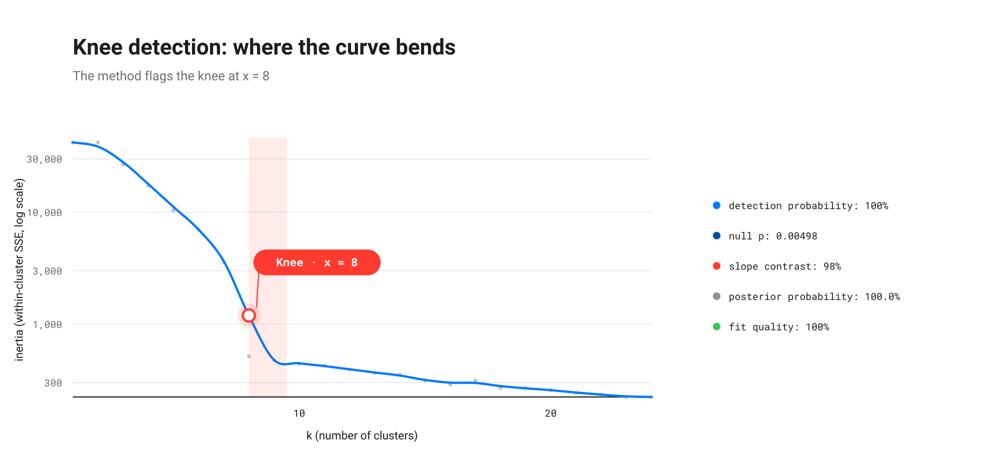

# EXAMPLES.md

[🇫🇷](EXEMPLES.md)&nbsp;&nbsp;|&nbsp;&nbsp;[🇬🇧](EXAMPLES.md)

Runnable recipes for `elbow-helper`. Every snippet below was executed against
the version named in [Setup](#setup), and every `text` block under it is that
run's real output, pasted unedited. See [`README.md`](README.md) for the full
API reference and the pipeline this all rests on.

## Table of Contents

- [Setup](#setup)
- [1. A clear, saturating knee](#1-a-clear-saturating-knee)
- [2. The k-means elbow (convex, decreasing)](#2-the-k-means-elbow-convex-decreasing)
- [3. Explicit abstention, not a fake knee](#3-explicit-abstention-not-a-fake-knee)
- [4. A saturating exponential curve](#4-a-saturating-exponential-curve)
- [5. Queueing latency: a capacity-planning knee](#5-queueing-latency-a-capacity-planning-knee)
- [6. Cache sizing: diminishing returns](#6-cache-sizing-diminishing-returns)
- [7. When to stop testing](#7-when-to-stop-testing)
- [8. The diagnostic figure](#8-the-diagnostic-figure)
- [9. The standalone locator](#9-the-standalone-locator)
- [10. Tuning the configuration](#10-tuning-the-configuration)
- [Command line](#command-line)
- [Troubleshooting](#troubleshooting)

## Setup

```bash
pip install elbow-helper
```

Two runtime dependencies beyond the standard library — `numpy` and
`os-helper` — plus `click` for the command line. No matplotlib: the diagnostic
figure in section 8 is hand-written SVG.

Every snippet assumes these imports, and sections 8 and 9 reuse the reference
curve defined here:

```python
import numpy as np

import elbow_helper
from elbow_helper import KneeLocator, RobustKneeConfig, robust_elbow, robust_knee
from elbow_helper.plotting import plot_diagnostics

print(elbow_helper.__version__)

# The reference curve sections 8 and 9 reuse: a line rising steeply to
# x = 0.30, then flattening, with 2% noise on top.
rng = np.random.default_rng(1)
x_ref = np.linspace(0.0, 1.0, 80)
y_ref = np.where(x_ref <= 0.30, 3.0 * x_ref, 3.0 * 0.30 + 0.2 * (x_ref - 0.30))
y_ref = y_ref / y_ref.max() + rng.normal(0, 0.02, x_ref.size)
print(f"{x_ref.size} points, y in [{y_ref.min():.3f}, {y_ref.max():.3f}]")
```

```text
0.4.0
80 points, y in [0.007, 1.008]
```

Every example passes `RobustKneeConfig(random_seed=0)` and seeds its own
generator, so the numbers below are the numbers you will get.

## 1. A clear, saturating knee

The most common case: a curve that rises, bends, and flattens, with enough
signal for the pipeline to commit to a point estimate.

```python
import numpy as np
from elbow_helper import RobustKneeConfig, robust_knee

rng = np.random.default_rng(1)
x = np.linspace(0.0, 1.0, 80)
knee = 0.30
y = np.where(x <= knee, 3.0 * x, 3.0 * knee + 0.2 * (x - knee))
y = y / y.max() + rng.normal(0, 0.02, x.size)

result = robust_knee(
    x, y, curve="concave", direction="increasing",
    config=RobustKneeConfig(random_seed=0),
)

print(result)
if result.is_clear:
    print(f"  true knee ~ {knee}, located at {result.knee_x:.3f}")
    print(f"  90% CI    = ({result.ci90[0]:.3f}, {result.ci90[1]:.3f})")
    print(f"  detection = {result.detection_rate:.2f}, null p = {result.null_p_value:.3g}")
```

```text
ClearKnee(knee_x=0.2785, ci90=(0.2658, 0.3291), detection_rate=0.99, null_p=0.00498)
  true knee ~ 0.3, located at 0.278
  90% CI    = (0.266, 0.329)
  detection = 0.99, null p = 0.00498
```

The point estimate never travels alone: `ci90` bounds it, `detection_rate`
says how often an independent resample of the noise finds the same knee, and
`null_p_value` says how surprising this knee would be if the curve were
secretly just a straight line plus noise. Note that the true break at 0.30
sits inside the interval while the point estimate lands just below it — read
`knee_x` with `ci90`, not on its own.

Full script: [`examples/clear_knee.py`](examples/clear_knee.py).

## 2. The k-means elbow (convex, decreasing)

`robust_elbow` is `robust_knee` with `curve`/`direction` pinned to the
classic scree-plot shape: inertia falling fast, then flattening as extra
clusters stop paying for themselves.

```python
import numpy as np
from elbow_helper import RobustKneeConfig, robust_elbow

rng = np.random.default_rng(3)
k = np.arange(1, 41, dtype=float)
inertia = np.where(k <= 8, 1000 - 90 * k, 280 - 3 * (k - 8))
inertia = inertia + rng.normal(0, 4.0, k.size)

result = robust_elbow(k, inertia, config=RobustKneeConfig(random_seed=0))

print(result)
if result.is_clear:
    print(f"  elbow at k = {result.knee_x:.1f}  (true k = 8)")
    print(f"  90% CI     = ({result.ci90[0]:.1f}, {result.ci90[1]:.1f})")
```

```text
ClearKnee(knee_x=8, ci90=(8, 8), detection_rate=1.00, null_p=0.00498)
  elbow at k = 8.0  (true k = 8)
  90% CI     = (8.0, 8.0)
```

A synthetic broken line with 40 points is the easy case: the elbow is exact
and the interval collapses onto it. For the same question on a real k-means
run — where inertia spans two orders of magnitude and the curve has to be
logged first — see `tests/test_real_world_examples.py` and this figure from
`doc/ELBOW-en.tex`, which plots inertia on a logarithmic axis and recovers the
true k = 8:



Full script: [`examples/kmeans_elbow.py`](examples/kmeans_elbow.py).

## 3. Explicit abstention, not a fake knee

A noisy but genuinely monotone straight line has no knee. The pipeline says
so, with a machine-readable reason, instead of returning a plausible-looking
but spurious point.

```python
import numpy as np
from elbow_helper import RobustKneeConfig, robust_knee

rng = np.random.default_rng(2)
x = np.linspace(0.0, 1.0, 80)
y = 0.2 + 0.5 * x + rng.normal(0, 0.01, x.size)  # monotone, no knee

result = robust_knee(
    x, y, curve="concave", direction="increasing",
    config=RobustKneeConfig(random_seed=0),
)

print(result)
print(f"  reason = {result.reason}")
```

```text
NoClearKnee(reason='NO_PERSISTENT_CLUSTER', detail='the strongest candidate location is x=0.4051, but it survives 1 consecutive smoothing scales, not 3, and it appears at 33% of the sensitivity settings, not 70%')
  reason = NO_PERSISTENT_CLUSTER
```

The reason code names the gate that closed; `detail` says by how much it
closed, in your own x units. Here the detector did find a candidate at
x = 0.4051 — it simply refused to keep it, because the candidate dissolves as
soon as the smoothing scale or the sensitivity setting moves. Every abstention
carries one of the fifteen reason codes documented in the README's "Abstention
reason codes" section; `result.diagnostics` has the full numeric trail behind
the decision, useful for tuning `RobustKneeConfig` against your own curve
family.

Full script: [`examples/no_knee.py`](examples/no_knee.py).

## 4. A saturating exponential curve

Charging voltages, learning curves, and dose-response curves all share the
`1 - exp(-t / tau)` shape: a rise that is fast at first, then approaches a
ceiling asymptotically. It is a useful stress test: unlike a broken-line knee,
it has no true slope discontinuity, it is smooth everywhere.

```python
import numpy as np
from elbow_helper import RobustKneeConfig, robust_knee

tau = 1.0
rng = np.random.default_rng(4)
t = np.linspace(0.0, 5.0 * tau, 150)
y = 1.0 - np.exp(-t / tau)
y = y + rng.normal(0, 0.01, t.size)

result = robust_knee(
    t, y, curve="concave", direction="increasing",
    config=RobustKneeConfig(random_seed=0),
)

print(result)
if result.is_clear:
    print(f"  knee at t = {result.knee_x:.3f}  (tau = {tau})")
    print(f"  rise at knee = {1 - np.exp(-result.knee_x / tau):.1%}")
```

```text
ClearKnee(knee_x=1.644, ci90=(1.577, 1.913), detection_rate=0.99, null_p=0.00498)
  knee at t = 1.644  (tau = 1.0)
  rise at knee = 80.7%
```

Worth knowing before reading too much into the exact number: the located knee
sits around **1.6 tau**, not 1 tau. The textbook "time constant" tau marks
`1 - e^-1 ≈ 63%` of the rise, mathematically clean but not where a curve
visually reads as "flattened". The pipeline, like a human eye, settles well
past that — at roughly 81% of the rise here. This ratio is a property of the
*observation window* as much as of the curve: measured over `t ∈ [0, 5·tau]`,
it would shift under a narrower or wider window, since the decision is about
maximum deviation from the chord spanning whatever range it is actually given,
not an intrinsic property of the infinite curve.

Full script: [`examples/exponential_saturation.py`](examples/exponential_saturation.py).

## 5. Queueing latency: a capacity-planning knee

A single-server queue's response time grows like `1 / (1 - rho)` in its
utilization `rho`, a classic M/M/1-style blow-up. This curve is convex and
increasing rather than the concave, saturating shapes above: the knee here
marks not a ceiling but an acceleration, the point past which a little
more load costs a lot more latency.

It is also the example where the shipped defaults say no:

```python
import numpy as np
from elbow_helper import RobustKneeConfig, robust_knee

baseline_ms = 8.0
rng = np.random.default_rng(7)
rho = np.linspace(0.02, 0.90, 150)
latency_ms = baseline_ms / (1.0 - rho)
latency_ms = latency_ms + rng.normal(0, 0.6, rho.size)

strict = RobustKneeConfig(random_seed=0)
first = robust_knee(rho, latency_ms, curve="convex", direction="increasing", config=strict)

print(first.reason)
print(first.detail)
```

```text
BOOTSTRAP_UNSTABLE
the knee does not hold up under resampling: resampling moves it 0.04725, over the 0.0264 allowed
```

Read what closed, not just that something closed. The knee was *found* on
every resample — what failed is positional precision: resampling the noise
slides it by 4.7% of the x-range, where the default tolerance is 2.6%. On a
smooth hyperbola there is no slope discontinuity to pin the knee to, so this
is the honest answer rather than a bug. If a knee to within ±5% of the range
is useful to you, say so explicitly and the pipeline will commit:

```python
relaxed = strict.with_(max_bootstrap_median_shift=0.06)
result = robust_knee(rho, latency_ms, curve="convex", direction="increasing", config=relaxed)

print(result)
if result.is_clear:
    knee_latency = baseline_ms / (1.0 - result.knee_x)
    print(f"  knee at utilization = {result.knee_x:.3f}  ({result.knee_x:.0%} of capacity)")
    print(f"  latency at knee     = {knee_latency:.1f} ms  ({knee_latency / baseline_ms:.1f}x baseline)")
```

```text
ClearKnee(knee_x=0.6342, ci90=(0.6224, 0.6874), detection_rate=1.00, null_p=0.00498)
  knee at utilization = 0.634  (63% of capacity)
  latency at knee     = 21.9 ms  (2.7x baseline)
```

The knee lands at 63% utilization, well before the mathematical blow-up at
100%, at about 2.7x the baseline latency. A queue is already paying a real tax
at 63% utilization: the curve only looks flat up to there because
`1 / (1 - rho)` is still small on an absolute scale. The widened tolerance is
the price of getting a number at all on a curve this smooth, and the 90%
interval — 0.622 to 0.687 — is the part to carry into a capacity plan.

Full script: [`examples/queueing_latency.py`](examples/queueing_latency.py).

## 6. Cache sizing: diminishing returns

How big should a cache be? For a working set with roughly power-law-popular
items, hit rate as a function of cache size `C` follows a Michaelis-Menten
shape, `C / (C + K)`, with `K` the cache size at which half the working set is
already resident. Concave and increasing, like the exponential above, but
built from a rational function rather than an exponential — and, like the
queueing curve, smooth enough that the defaults abstain:

```python
import numpy as np
from elbow_helper import RobustKneeConfig, robust_knee

K = 200.0
rng = np.random.default_rng(11)
cache_size = np.linspace(10, 2000, 150)
hit_rate = cache_size / (cache_size + K)
hit_rate = hit_rate + rng.normal(0, 0.01, cache_size.size)

strict = RobustKneeConfig(random_seed=0)
first = robust_knee(cache_size, hit_rate, curve="concave", direction="increasing", config=strict)

print(first.reason)
print(first.detail)
```

```text
BOOTSTRAP_UNSTABLE
the knee does not hold up under resampling: it survives only 82% of resamples, not 90%
```

A different failure from section 5: here the knee is precise when it appears,
but it does not appear often enough — 82% of resamples against a 90%
requirement. Accepting an 82% detection rate is a decision a reader can
audit, so it has to be written down:

```python
relaxed = strict.with_(min_bootstrap_detection_rate=0.80)
result = robust_knee(cache_size, hit_rate, curve="concave", direction="increasing", config=relaxed)

print(result)
if result.is_clear:
    print(f"  knee at cache size = {result.knee_x:.0f} items  ({result.knee_x / K:.2f}x K)")
    print(f"  hit rate at knee   = {result.knee_x / (result.knee_x + K):.1%}")
```

```text
ClearKnee(knee_x=490.8, ci90=(477.4, 556.9), detection_rate=0.82, null_p=0.00498)
  knee at cache size = 491 items  (2.45x K)
  hit rate at knee   = 71.0%
```

The knee lands around `2.5 * K`, not at `K` itself. `K` only marks the
50%-hit-rate point, a property of the formula's algebra, not of where the
*marginal* return on cache size actually stops paying off. Buying cache up to
`K` leaves cheap hit rate on the table; past roughly `2.5 * K` you are
spending real memory for a shrinking sliver of hits.

Full script: [`examples/cache_hit_rate.py`](examples/cache_hit_rate.py).

## 7. When to stop testing

Reliability-growth models describe defect discovery during testing as fast
at first (the easy, high-impact bugs) then slow (the rare, deep ones): a
curve that falls steeply, bends, and flattens into a long, low tail. The
same convex/decreasing family as the k-means and PCA examples, run on a
release-engineering question instead of a clustering or dimensionality
one.

```python
import numpy as np
from elbow_helper import RobustKneeConfig, robust_knee

true_knee_day = 10.0
rng = np.random.default_rng(13)
days = np.linspace(1, 30, 120)
bugs_per_day = np.where(
    days <= true_knee_day,
    14.0 - 1.1 * days,
    2.0 - 0.05 * (days - true_knee_day),
)
bugs_per_day = np.clip(bugs_per_day + rng.normal(0, 0.3, days.size), 0, None)

result = robust_knee(
    days, bugs_per_day, curve="convex", direction="decreasing",
    config=RobustKneeConfig(random_seed=0),
)

print(result)
if result.is_clear:
    print(f"  knee at day = {result.knee_x:.1f}  (true knee = {true_knee_day:.0f})")
```

```text
ClearKnee(knee_x=10.5, ci90=(10.26, 10.75), detection_rate=1.00, null_p=0.00498)
  knee at day = 10.5  (true knee = 10)
```

The located knee sits about half a day past the true break, the same small,
systematic "a little past the true bend" offset the PCA scree example shows in
`doc/ELBOW-en.tex`. Reading `knee_x` as "stop testing exactly here" rather
than "the discovery rate has now genuinely flattened, give or take the
interval" over-trusts the point estimate past what it actually claims.

Full script: [`examples/bug_discovery_rate.py`](examples/bug_discovery_rate.py).

## 8. The diagnostic figure

`elbow_helper.plotting` needs no extra install: it writes a self-contained
SVG by hand, no matplotlib. It returns the document as a string and, with
`out=`, also writes it to disk.

```python
from elbow_helper import RobustKneeConfig
from elbow_helper.plotting import plot_diagnostics

svg = plot_diagnostics(
    x_ref, y_ref, curve="concave", direction="increasing",
    config=RobustKneeConfig(random_seed=0),
    out="diagnostics.svg",
    language="en",   # or "fr"
)

print(svg[:30])
print(len(svg), "characters of standalone SVG")
```

```text
<svg xmlns="http://www.w3.org/
13116 characters of standalone SVG
```

The figure shows the curve with its located knee and 90% CI band (or, on
abstention, a greyed dashed curve and the reason) next to a compact evidence
legend: detection probability, null-model p-value, slope contrast, a
BIC-derived posterior model probability (a bounded `[0, 1]` reading, e.g.
"99.9%", not the raw, unbounded `bic_improvement` nats the API itself
returns, since a raw log-likelihood difference has no natural scale to
compare against), and a fit-quality score normalized against a
deliberately pessimistic worst case (the hardest single observed point to
predict everything else from) rather than the sample mean, which a real
fit can too easily do worse than. See `doc/ELBOW-en.tex` for the
derivation of both normalizations.

`raw_axis=True` plots in your own units instead of the pipeline's normalized
unit square, and then `log_y=True`, `x_label=` and `y_label=` apply.

Full script: [`examples/diagnostic_plot.py`](examples/diagnostic_plot.py).

## 9. The standalone locator

The from-scratch bump-peak locator underneath `robust_knee` is usable on its
own, without the full conservative pipeline: no bootstrap, no null test, no
persistence clustering, just the geometric peak-finding step.

```python
from elbow_helper import KneeLocator

kl = KneeLocator(x_ref, y_ref, S=1.0, curve="concave", direction="increasing")
print(f"first knee      = {kl.knee:.4f}")

online = KneeLocator(x_ref, y_ref, S=1.0, curve="concave", direction="increasing", online=True)
print(f"online knee     = {online.knee:.4f}   ({len(online.all_knees)} candidates in all)")
print(f"earliest of all = {min(online.all_knees):.4f}")
```

```text
first knee      = 0.2911
online knee     = 0.9873   (18 candidates in all)
earliest of all = 0.2911
```

Mind `online`. It defaults to `False`, which stops at the first knee — 0.2911
here, right on the true break at 0.30. With `online=True` the locator re-arms
at every later, higher peak and `kl.knee` ends up being the *last* one it
found, 0.9873, which is noise at the tail rather than the bend. On a noisy
curve that is almost never the answer you want from a bare locator; it is
`all_knees` that is interesting, and sifting those 18 candidates is exactly
the job `robust_knee` does for you.

Useful for exploring a curve interactively or as a building block in your
own pipeline; `robust_knee` is the one to reach for when you need the
uncertainty estimate and the abstention guarantee.

## 10. Tuning the configuration

Every threshold lives in `RobustKneeConfig`, a frozen dataclass. The shipped
defaults favour speed (modest replicate counts, a run finishes in seconds);
raise them for a validation-grade run:

```python
from elbow_helper import RobustKneeConfig

config = RobustKneeConfig(bootstrap_replicates=100, null_replicates=200)
validation = config.with_(bootstrap_replicates=500, null_replicates=1000)

print(config.bootstrap_replicates, config.null_replicates)
print(validation.bootstrap_replicates, validation.null_replicates)
print(config.cluster_tolerance, config.max_neighbor_shift)
```

```text
100 200
500 1000
0.06 0.07
```

`cluster_tolerance` and `max_neighbor_shift` are the two most worth
recalibrating for your own data: they sit slightly above the 0.05 reference
value to absorb the locator's discretisation jitter at modest sample sizes
(n around 60-100). Tighten them for cleaner, larger datasets, loosen them
for noisier or shorter ones. Sections 5 and 6 show the same move applied to
the two bootstrap gates.

## Command line

One `click` command, four subcommands, the same shared core the Python API and
the HTTP/MCP doors call. Every result is printed as indented JSON, except
`diagnostics`, which prints raw SVG.

```console
$ elbow-helper --help
Usage: elbow-helper [OPTIONS] COMMAND [ARGS]...

  Noise-robust knee/elbow detection: a knee with uncertainty, or an explicit
  abstention.

Options:
  -V, --version  Show the version and exit.
  -v, --verbose  repeat for more logs
  -h, --help     Show this message and exit.

Commands:
  diagnostics  Render the diagnostic SVG.
  elbow        The convex/decreasing convenience (k-means elbow).
  knee         Locate a knee with uncertainty, or abstain.
  locator      The standalone locator (no uncertainty evidence).
```

Each subcommand reads its series from exactly one of `--y-values` (inline
comma-separated floats), `--y-npy` (a 1-D `.npy` file) or `--y-csv`
(`PATH:COLUMN_INDEX`), and the same three flags exist on the x side. `knee`
accepts a y-only shorthand, plotting against `0, 1, ..., n-1`; `elbow` and
`locator` need both series.

The bare locator is the terse one:

```console
$ elbow-helper locator \
    --x-values 0,1,2,3,4,5,6,7,8,9,10,11,12,13,14,15,16,17,18,19,20,21,22,23,24 \
    --y-values 0,1,2,3,4,5,6,7,8,8.1,8.2,8.3,8.4,8.5,8.6,8.7,8.8,8.9,9,9.1,9.2,9.3,9.4,9.5,9.6
{
  "knee": 8.0,
  "all_knees": [
    8.0
  ]
}
```

`elbow` returns the full evidence record. The `diagnostics` key under it is
the long part — the whole numeric trail behind the verdict — so this pipes it
away to keep the headline readable:

```console
$ elbow-helper elbow \
    --x-values 0,1,2,3,4,5,6,7,8,9,10,11,12,13,14,15,16,17,18,19,20,21,22,23,24 \
    --y-values 100,90,80,70,60,50,40,30,20,19.5,19,18.5,18,17.5,17,16.5,16,15.5,15,14.5,14,13.5,13,12.5,12 \
  | python -c "import json,sys; d=json.load(sys.stdin); d.pop('diagnostics'); print(json.dumps(d, indent=2))"
{
  "reason": "CLEAR_KNEE",
  "knee_x": 8.0,
  "knee_x_norm": 0.3333333333333333,
  "knee_index": 8,
  "ci90": [
    8.0,
    8.0
  ],
  "detection_rate": 1.0,
  "smoothing_window": 1,
  "sensitivity": 1.0,
  "prominence": 0.5359800928548719,
  "slope_contrast": 0.9047619044459562,
  "bic_improvement": 678.194141124372,
  "null_p_value": 0.004975124378109453,
  "is_clear": true
}
```

`--config-json` passes `RobustKneeConfig` overrides through as a JSON object,
so the relaxations in sections 5 and 6 work from the shell too:
`--config-json '{"min_bootstrap_detection_rate": 0.8}'`. `diagnostics` adds
`--out PATH` and `--language en|fr`.

The same core is also reachable over HTTP and MCP; see the README's
"CLI / API / MCP" section for the two server entry points.

## Troubleshooting

**`INSUFFICIENT_DATA` on a short curve.** The defaults are calibrated for
measurement curves of a few dozen points or more, and they say so rather than
guessing:

```python
import numpy as np
from elbow_helper import RobustKneeConfig, robust_knee

short_x = np.arange(8.0)
short_y = np.array([0.0, 1.0, 2.0, 3.0, 3.1, 3.2, 3.3, 3.4])

result = robust_knee(short_x, short_y, config=RobustKneeConfig(random_seed=0))
print(result.reason)
print(result.detail)
```

```text
INSUFFICIENT_DATA
8 usable points, under the 20 this detector is calibrated for. Its persistence and bootstrap gates need a scale space to work across; below that they measure noise. Pass a config with a lower min_samples to try anyway, and read the result as indicative rather than confirmed
```

A k-means scree plot out to k = 10 is exactly this case. The retuned profile
that makes short applied curves work is in
[`tests/test_real_world_examples.py`](tests/test_real_world_examples.py) —
lower `min_samples` and `min_side_points`, wider CV folds — and the trade-off
is spelled out there.

**A curve spanning orders of magnitude lands in the wrong place.** The
detector works on the curve normalized into the unit square, so a `y` that
falls from 80000 to 300 crushes its own tail into the bottom fraction of that
square. Take the logarithm first:

```python
import numpy as np
from elbow_helper import RobustKneeConfig, robust_knee

k = np.arange(1, 25, dtype=float)
inertia = 80000 * np.exp(-0.55 * k) + 300
config = RobustKneeConfig(random_seed=0)

print("raw:", robust_knee(k, inertia, curve="convex", direction="decreasing", config=config))
print("log:", robust_knee(k, np.log(inertia), curve="convex", direction="decreasing", config=config))
```

```text
raw: ClearKnee(knee_x=6, ci90=(6, 6), detection_rate=1.00, null_p=0.00498)
log: ClearKnee(knee_x=11, ci90=(11, 12), detection_rate=0.93, null_p=0.00498)
```

Both runs are confident, and they disagree by five units. Neither is a bug:
the detector found the corner of the shape it was handed, and taking the log
hands it a different shape. The curve as a practitioner plots it — on a
logarithmic axis — is the one whose corner is worth reading. See the README's
"Curves spanning orders of magnitude" section.

**`BOOTSTRAP_UNSTABLE` on a smooth curve.** Expected on anything without a
true slope discontinuity; sections 5 and 6 work through both variants of it
and which gate to loosen for each.

**Abstention with no `detail` worth acting on.** `result.diagnostics` carries
the full numeric trail — every gate, its measurement and its threshold — which
is the input to deciding whether the curve is hopeless or merely
under-measured.
