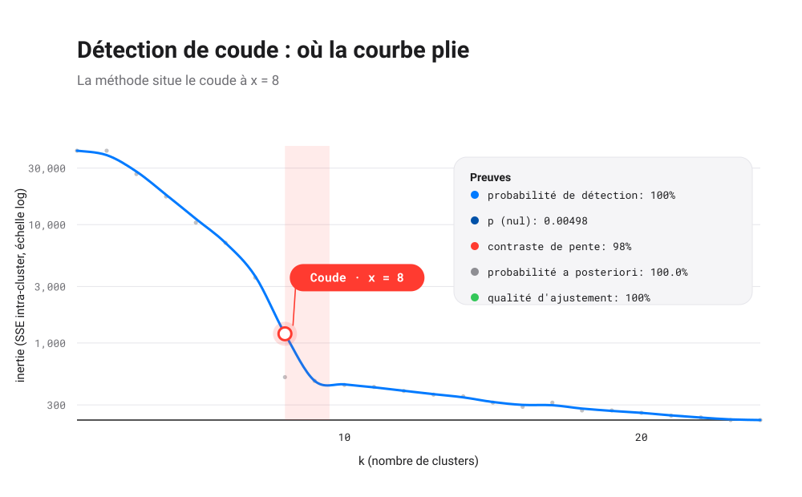

# EXEMPLES.md

[🇫🇷](EXEMPLES.md)&nbsp;&nbsp;|&nbsp;&nbsp;[🇬🇧](EXAMPLES.md)

Des recettes exécutables pour `elbow-helper`. Chaque extrait ci-dessous a été
lancé contre la version annoncée en [Mise en place](#mise-en-place) ; chaque
bloc `text` qui le suit est la sortie réelle de cette exécution, collée telle
quelle. Voir [`LISEZMOI.md`](LISEZMOI.md) pour la référence complète de l'API
et le pipeline sur lequel tout ceci repose.

## Table des matières

- [Mise en place](#mise-en-place)
- [1. Un coude net, à saturation](#1-un-coude-net-à-saturation)
- [2. Le coude de k-means (convexe, décroissant)](#2-le-coude-de-k-means-convexe-décroissant)
- [3. Abstention explicite, pas un faux coude](#3-abstention-explicite-pas-un-faux-coude)
- [4. Une courbe exponentielle à saturation](#4-une-courbe-exponentielle-à-saturation)
- [5. Latence de file d'attente : un coude de dimensionnement](#5-latence-de-file-dattente--un-coude-de-dimensionnement)
- [6. Dimensionner un cache : rendements décroissants](#6-dimensionner-un-cache--rendements-décroissants)
- [7. Quand arrêter les tests](#7-quand-arrêter-les-tests)
- [8. La figure de diagnostic](#8-la-figure-de-diagnostic)
- [9. Le repéreur autonome](#9-le-repéreur-autonome)
- [10. Régler la configuration](#10-régler-la-configuration)
- [Ligne de commande](#ligne-de-commande)
- [Dépannage](#dépannage)

## Mise en place

```bash
pip install elbow-helper
```

Deux dépendances d'exécution au-delà de la bibliothèque standard — `numpy` et
`os-helper` — plus `click` pour la ligne de commande. Pas de matplotlib : la
figure de diagnostic de la section 8 est du SVG écrit à la main.

Tous les extraits supposent ces imports ; les sections 8 et 9 réutilisent la
courbe de référence définie ici :

```python
import numpy as np

import elbow_helper
from elbow_helper import KneeLocator, RobustKneeConfig, robust_elbow, robust_knee
from elbow_helper.plotting import plot_diagnostics

print(elbow_helper.__version__)

# La courbe de référence que réutilisent les sections 8 et 9 : une droite qui
# monte fort jusqu'à x = 0,30, puis s'aplatit, avec 2 % de bruit par-dessus.
rng = np.random.default_rng(1)
x_ref = np.linspace(0.0, 1.0, 80)
y_ref = np.where(x_ref <= 0.30, 3.0 * x_ref, 3.0 * 0.30 + 0.2 * (x_ref - 0.30))
y_ref = y_ref / y_ref.max() + rng.normal(0, 0.02, x_ref.size)
print(f"{x_ref.size} points, y dans [{y_ref.min():.3f}, {y_ref.max():.3f}]")
```

```text
0.4.0
80 points, y dans [0.007, 1.008]
```

Chaque exemple passe `RobustKneeConfig(random_seed=0)` et amorce son propre
générateur : les nombres ci-dessous sont donc ceux que vous obtiendrez.

## 1. Un coude net, à saturation

Le cas le plus courant : une courbe qui monte, plie, puis s'aplatit, avec
assez de signal pour que le pipeline s'engage sur une estimation ponctuelle.

```python
import numpy as np
from elbow_helper import RobustKneeConfig, robust_knee

rng = np.random.default_rng(1)
x = np.linspace(0.0, 1.0, 80)
knee = 0.30
y = np.where(x <= knee, 3.0 * x, 3.0 * knee + 0.2 * (x - knee))
y = y / y.max() + rng.normal(0, 0.02, x.size)

result = robust_knee(
    x, y, curve="concave", direction="increasing",
    config=RobustKneeConfig(random_seed=0),
)

print(result)
if result.is_clear:
    print(f"  coude réel ~ {knee}, repéré en {result.knee_x:.3f}")
    print(f"  IC 90%     = ({result.ci90[0]:.3f}, {result.ci90[1]:.3f})")
    print(f"  détection  = {result.detection_rate:.2f}, p nulle = {result.null_p_value:.3g}")
```

```text
ClearKnee(knee_x=0.2785, ci90=(0.2658, 0.3291), detection_rate=0.99, null_p=0.00498)
  coude réel ~ 0.3, repéré en 0.278
  IC 90%     = (0.266, 0.329)
  détection  = 0.99, p nulle = 0.00498
```

L'estimation ponctuelle ne voyage jamais seule : `ci90` l'encadre,
`detection_rate` indique la fréquence à laquelle un rééchantillonnage
indépendant du bruit retrouve le même coude ; `null_p_value` dit à quel
point ce coude serait surprenant si la courbe n'était en réalité qu'une
droite plus du bruit. À noter : la vraie rupture à 0,30 tombe dans
l'intervalle alors que l'estimation ponctuelle se pose juste en dessous. Il
faut donc lire `knee_x` avec `ci90`, jamais seul.

Script complet : [`examples/clear_knee.py`](examples/clear_knee.py).

## 2. Le coude de k-means (convexe, décroissant)

`robust_elbow` est `robust_knee` avec `curve`/`direction` figés sur la forme
classique d'un graphe d'éboulis : l'inertie chute vite, puis s'aplatit à
mesure que les groupes supplémentaires cessent d'être rentables.

```python
import numpy as np
from elbow_helper import RobustKneeConfig, robust_elbow

rng = np.random.default_rng(3)
k = np.arange(1, 41, dtype=float)
inertia = np.where(k <= 8, 1000 - 90 * k, 280 - 3 * (k - 8))
inertia = inertia + rng.normal(0, 4.0, k.size)

result = robust_elbow(k, inertia, config=RobustKneeConfig(random_seed=0))

print(result)
if result.is_clear:
    print(f"  coude en k = {result.knee_x:.1f}  (vrai k = 8)")
    print(f"  IC 90%     = ({result.ci90[0]:.1f}, {result.ci90[1]:.1f})")
```

```text
ClearKnee(knee_x=8, ci90=(8, 8), detection_rate=1.00, null_p=0.00498)
  coude en k = 8.0  (vrai k = 8)
  IC 90%     = (8.0, 8.0)
```

Une ligne brisée synthétique de 40 points est le cas facile : le coude est
exact et l'intervalle se referme dessus. Pour la même question sur un vrai
k-means — où l'inertie s'étend sur deux ordres de grandeur et où la courbe
doit d'abord passer au logarithme — voir `tests/test_real_world_examples.py`
ainsi que cette figure de `doc/ELBOW-fr.tex`, qui trace l'inertie sur un axe
logarithmique et retrouve le vrai k = 8 :



Script complet : [`examples/kmeans_elbow.py`](examples/kmeans_elbow.py).

## 3. Abstention explicite, pas un faux coude

Une droite monotone, bruitée mais bel et bien droite, n'a pas de coude. Le
pipeline le dit, avec un motif lisible par une machine, au lieu de renvoyer
un point plausible mais fallacieux.

```python
import numpy as np
from elbow_helper import RobustKneeConfig, robust_knee

rng = np.random.default_rng(2)
x = np.linspace(0.0, 1.0, 80)
y = 0.2 + 0.5 * x + rng.normal(0, 0.01, x.size)  # monotone, sans coude

result = robust_knee(
    x, y, curve="concave", direction="increasing",
    config=RobustKneeConfig(random_seed=0, language="fr"),
)

print(result)
print(f"  motif = {result.reason}")
```

```text
NoClearKnee(reason='NO_PERSISTENT_CLUSTER', detail="le meilleur emplacement candidat est x=0.4051, mais il ne survit qu'à 1 échelles de lissage consécutives au lieu de 3 ; il n'apparaît qu'à 33\xa0% des réglages de sensibilité au lieu de 70\xa0%")
  motif = NO_PERSISTENT_CLUSTER
```

Le code de motif nomme la porte qui s'est fermée ; `detail` dit de combien
elle s'est fermée, dans vos propres unités de x. Ici le détecteur a bien
trouvé un candidat en x = 0,4051 — il a simplement refusé de le garder, parce
que ce candidat se dissout dès que l'échelle de lissage ou le réglage de
sensibilité bouge. `language="fr"` ne change que la prose : le code de motif,
chaque seuil et chaque mesure sont identiques dans les deux langues. Toute
abstention porte l'un des quinze codes documentés dans la section « Codes
d'abstention » du LISEZMOI ; `result.diagnostics` contient toute la trace
numérique derrière la décision, utile pour régler `RobustKneeConfig` sur
votre propre famille de courbes.

Script complet : [`examples/no_knee.py`](examples/no_knee.py).

## 4. Une courbe exponentielle à saturation

Tensions de charge, courbes d'apprentissage et courbes dose-réponse
partagent la forme `1 - exp(-t / tau)` : une montée rapide au début, puis une
approche asymptotique d'un plafond. C'est un bon test de résistance :
contrairement à une ligne brisée, elle n'a aucune vraie discontinuité de
pente, elle est lisse partout.

```python
import numpy as np
from elbow_helper import RobustKneeConfig, robust_knee

tau = 1.0
rng = np.random.default_rng(4)
t = np.linspace(0.0, 5.0 * tau, 150)
y = 1.0 - np.exp(-t / tau)
y = y + rng.normal(0, 0.01, t.size)

result = robust_knee(
    t, y, curve="concave", direction="increasing",
    config=RobustKneeConfig(random_seed=0),
)

print(result)
if result.is_clear:
    print(f"  coude en t = {result.knee_x:.3f}  (tau = {tau})")
    print(f"  montée au coude = {1 - np.exp(-result.knee_x / tau):.1%}")
```

```text
ClearKnee(knee_x=1.644, ci90=(1.577, 1.913), detection_rate=0.99, null_p=0.00498)
  coude en t = 1.644  (tau = 1.0)
  montée au coude = 80.7%
```

À savoir avant de lire trop de choses dans le nombre exact : le coude repéré
se situe vers **1,6 tau**, pas 1 tau. La « constante de temps » tau des
manuels marque `1 - e^-1 ≈ 63 %` de la montée, mathématiquement propre mais
pas l'endroit où une courbe se lit visuellement comme « aplatie ». Le
pipeline, comme l'œil humain, se pose bien plus loin : ici à environ 81 % de
la montée. Ce rapport est une propriété de la *fenêtre d'observation* autant
que de la courbe : mesuré sur `t ∈ [0, 5·tau]`, il se déplacerait avec une
fenêtre plus étroite ou plus large, puisque la décision porte sur l'écart
maximal à la corde qui enjambe la plage effectivement fournie, pas sur une
propriété intrinsèque de la courbe infinie.

Script complet : [`examples/exponential_saturation.py`](examples/exponential_saturation.py).

## 5. Latence de file d'attente : un coude de dimensionnement

Le temps de réponse d'une file à serveur unique croît comme `1 / (1 - rho)`
en son taux d'occupation `rho` : l'explosion classique d'une M/M/1. Cette
courbe est convexe et croissante, à l'inverse des formes concaves à
saturation ci-dessus : le coude n'y marque pas un plafond mais une
accélération, le point au-delà duquel un peu plus de charge coûte beaucoup
plus de latence.

C'est aussi l'exemple où les réglages livrés disent non :

```python
import numpy as np
from elbow_helper import RobustKneeConfig, robust_knee

baseline_ms = 8.0
rng = np.random.default_rng(7)
rho = np.linspace(0.02, 0.90, 150)
latency_ms = baseline_ms / (1.0 - rho)
latency_ms = latency_ms + rng.normal(0, 0.6, rho.size)

strict = RobustKneeConfig(random_seed=0, language="fr")
first = robust_knee(rho, latency_ms, curve="convex", direction="increasing", config=strict)

print(first.reason)
print(first.detail)
```

```text
BOOTSTRAP_UNSTABLE
le coude ne résiste pas au rééchantillonnage : le rééchantillonnage le déplace de 0.04725, au-delà des 0.0264 tolérés
```

Il faut lire *ce* qui s'est fermé, pas seulement que quelque chose s'est
fermé. Le coude a été *trouvé* à chaque rééchantillon : ce qui a échoué,
c'est la précision de position. Rééchantillonner le bruit le fait glisser de
4,7 % de l'étendue en x, là où la tolérance par défaut est de 2,6 %. Sur une
hyperbole lisse il n'y a aucune discontinuité de pente où épingler le coude :
c'est donc la réponse honnête, pas un défaut. Si un coude à ±5 % de l'étendue
vous est utile, dites-le explicitement et le pipeline s'engagera :

```python
relaxed = strict.with_(max_bootstrap_median_shift=0.06)
result = robust_knee(rho, latency_ms, curve="convex", direction="increasing", config=relaxed)

print(result)
if result.is_clear:
    knee_latency = baseline_ms / (1.0 - result.knee_x)
    print(f"  coude au taux d'occupation = {result.knee_x:.3f}  ({result.knee_x:.0%} de la capacité)")
    print(f"  latence au coude           = {knee_latency:.1f} ms  ({knee_latency / baseline_ms:.1f}x la base)")
```

```text
ClearKnee(knee_x=0.6342, ci90=(0.6224, 0.6874), detection_rate=1.00, null_p=0.00498)
  coude au taux d'occupation = 0.634  (63% de la capacité)
  latence au coude           = 21.9 ms  (2.7x la base)
```

Le coude se pose à 63 % d'occupation, bien avant l'explosion mathématique à
100 %, à environ 2,7 fois la latence de base. Une file paie déjà un vrai
impôt à 63 % d'occupation : la courbe ne paraît plate jusque-là que parce que
`1 / (1 - rho)` reste petit en valeur absolue. La tolérance élargie est le
prix à payer pour obtenir un nombre sur une courbe aussi lisse, et
l'intervalle à 90 % — de 0,622 à 0,687 — est la partie à reporter dans un
plan de capacité.

Script complet : [`examples/queueing_latency.py`](examples/queueing_latency.py).

## 6. Dimensionner un cache : rendements décroissants

Quelle taille donner à un cache ? Pour un ensemble de travail dont la
popularité suit à peu près une loi de puissance, le taux de succès en
fonction de la taille `C` suit une forme de Michaelis-Menten, `C / (C + K)`,
où `K` est la taille à laquelle la moitié de l'ensemble de travail est déjà
résidente. Concave et croissante, comme l'exponentielle ci-dessus, mais bâtie
sur une fonction rationnelle plutôt qu'une exponentielle — et, comme la
courbe de file d'attente, assez lisse pour que les réglages par défaut
s'abstiennent :

```python
import numpy as np
from elbow_helper import RobustKneeConfig, robust_knee

K = 200.0
rng = np.random.default_rng(11)
cache_size = np.linspace(10, 2000, 150)
hit_rate = cache_size / (cache_size + K)
hit_rate = hit_rate + rng.normal(0, 0.01, cache_size.size)

strict = RobustKneeConfig(random_seed=0, language="fr")
first = robust_knee(cache_size, hit_rate, curve="concave", direction="increasing", config=strict)

print(first.reason)
print(first.detail)
```

```text
BOOTSTRAP_UNSTABLE
le coude ne résiste pas au rééchantillonnage : il ne survit qu'à 82 % des rééchantillons au lieu de 90 %
```

Un échec différent de celui de la section 5 : ici le coude est précis quand
il apparaît, mais il n'apparaît pas assez souvent — 82 % des rééchantillons
contre 90 % exigés. Accepter un taux de détection de 82 % est une décision
qu'un lecteur peut auditer : elle doit donc être écrite noir sur blanc.

```python
relaxed = strict.with_(min_bootstrap_detection_rate=0.80)
result = robust_knee(cache_size, hit_rate, curve="concave", direction="increasing", config=relaxed)

print(result)
if result.is_clear:
    print(f"  coude à une taille de cache de {result.knee_x:.0f} entrées  ({result.knee_x / K:.2f}x K)")
    print(f"  taux de succès au coude        = {result.knee_x / (result.knee_x + K):.1%}")
```

```text
ClearKnee(knee_x=490.8, ci90=(477.4, 556.9), detection_rate=0.82, null_p=0.00498)
  coude à une taille de cache de 491 entrées  (2.45x K)
  taux de succès au coude        = 71.0%
```

Le coude se pose autour de `2,5 * K`, pas en `K` lui-même. `K` ne marque que
le point à 50 % de succès, une propriété de l'algèbre de la formule, pas de
l'endroit où le rendement *marginal* de la taille du cache cesse d'être
rentable. Acheter du cache jusqu'à `K` laisse du taux de succès bon marché
sur la table ; au-delà d'environ `2,5 * K`, on dépense de la vraie mémoire
pour une tranche de succès qui se rétrécit.

Script complet : [`examples/cache_hit_rate.py`](examples/cache_hit_rate.py).

## 7. Quand arrêter les tests

Les modèles de croissance de fiabilité décrivent la découverte de défauts
pendant les tests comme rapide d'abord (les bogues faciles, à fort impact)
puis lente (les rares, les profonds) : une courbe qui chute fort, plie, puis
s'aplatit en une longue traîne basse. La même famille convexe/décroissante
que les exemples k-means et ACP, appliquée à une question d'ingénierie de
release plutôt qu'à du partitionnement ou de la réduction de dimension.

```python
import numpy as np
from elbow_helper import RobustKneeConfig, robust_knee

true_knee_day = 10.0
rng = np.random.default_rng(13)
days = np.linspace(1, 30, 120)
bugs_per_day = np.where(
    days <= true_knee_day,
    14.0 - 1.1 * days,
    2.0 - 0.05 * (days - true_knee_day),
)
bugs_per_day = np.clip(bugs_per_day + rng.normal(0, 0.3, days.size), 0, None)

result = robust_knee(
    days, bugs_per_day, curve="convex", direction="decreasing",
    config=RobustKneeConfig(random_seed=0),
)

print(result)
if result.is_clear:
    print(f"  coude au jour {result.knee_x:.1f}  (vrai coude = {true_knee_day:.0f})")
```

```text
ClearKnee(knee_x=10.5, ci90=(10.26, 10.75), detection_rate=1.00, null_p=0.00498)
  coude au jour 10.5  (vrai coude = 10)
```

Le coude repéré se situe environ une demi-journée après la vraie rupture, le
même petit décalage systématique « un peu après le vrai pli » que montre
l'exemple du graphe d'éboulis ACP dans `doc/ELBOW-fr.tex`. Lire `knee_x`
comme « arrêter les tests exactement ici » plutôt que « le rythme de
découverte s'est vraiment aplati, à l'intervalle près » accorde au point
estimé plus de confiance qu'il n'en revendique.

Script complet : [`examples/bug_discovery_rate.py`](examples/bug_discovery_rate.py).

## 8. La figure de diagnostic

`elbow_helper.plotting` ne demande aucune installation supplémentaire : il
écrit du SVG autonome à la main, sans matplotlib. La fonction renvoie le
document sous forme de chaîne et, avec `out=`, l'écrit aussi sur le disque.

```python
from elbow_helper import RobustKneeConfig
from elbow_helper.plotting import plot_diagnostics

svg = plot_diagnostics(
    x_ref, y_ref, curve="concave", direction="increasing",
    config=RobustKneeConfig(random_seed=0),
    out="diagnostics.svg",
    language="fr",   # ou "en"
)

print(svg[:30])
print(len(svg), "caractères de SVG autonome")
```

```text
<svg xmlns="http://www.w3.org/
13146 caractères de SVG autonome
```

La figure montre la courbe avec son coude repéré et sa bande d'IC à 90 % (ou,
en cas d'abstention, une courbe grisée en pointillés et le motif), à côté
d'une légende de preuves compacte : probabilité de détection, p-valeur sous
modèle nul, contraste de pente, une probabilité de modèle a posteriori
dérivée du BIC (une lecture bornée dans `[0, 1]`, par exemple « 99,9 % », et
non les nats bruts et non bornés de `bic_improvement` que l'API renvoie
elle-même, puisqu'une différence de log-vraisemblance n'a aucune échelle
naturelle de comparaison) et un score de qualité d'ajustement normalisé
contre un pire cas délibérément pessimiste (le point observé le plus difficile
à partir duquel prédire tous les autres) plutôt que contre la moyenne de
l'échantillon, qu'un ajustement réel peut trop facilement faire moins bien.
Voir `doc/ELBOW-fr.tex` pour la dérivation des deux normalisations.

`raw_axis=True` trace dans vos unités d'origine au lieu du carré unité
normalisé du pipeline ; `log_y=True`, `x_label=` et `y_label=` s'appliquent
alors.

Script complet : [`examples/diagnostic_plot.py`](examples/diagnostic_plot.py).

## 9. Le repéreur autonome

Le repéreur de pic de bosse écrit de zéro sous `robust_knee` est utilisable
seul, sans le pipeline conservateur complet : pas de bootstrap, pas de test
nul, pas de regroupement par persistance, juste l'étape géométrique de
recherche de pic.

```python
from elbow_helper import KneeLocator

kl = KneeLocator(x_ref, y_ref, S=1.0, curve="concave", direction="increasing")
print(f"premier coude   = {kl.knee:.4f}")

online = KneeLocator(x_ref, y_ref, S=1.0, curve="concave", direction="increasing", online=True)
print(f"coude online    = {online.knee:.4f}   ({len(online.all_knees)} candidats en tout)")
print(f"le plus précoce = {min(online.all_knees):.4f}")
```

```text
premier coude   = 0.2911
coude online    = 0.9873   (18 candidats en tout)
le plus précoce = 0.2911
```

Attention à `online`. Sa valeur par défaut est `False`, ce qui arrête le
parcours au premier coude — 0,2911 ici, pile sur la vraie rupture à 0,30.
Avec `online=True`, le repéreur se réarme à chaque pic ultérieur plus haut et
`kl.knee` finit par être le *dernier* trouvé, 0,9873, c'est-à-dire du bruit de
queue plutôt que le pli. Sur une courbe bruitée, ce n'est presque jamais la
réponse qu'on attend d'un repéreur nu : c'est `all_knees` qui est
intéressant ; trier ces 18 candidats est exactement le travail que
`robust_knee` fait pour vous.

Utile pour explorer une courbe de façon interactive ou comme brique dans
votre propre pipeline ; `robust_knee` est celui vers lequel se tourner quand
il faut l'estimation d'incertitude et la garantie d'abstention.

## 10. Régler la configuration

Tous les seuils vivent dans `RobustKneeConfig`, une dataclass gelée. Les
valeurs livrées privilégient la vitesse (nombres de réplicats modestes, une
exécution se termine en quelques secondes) ; relevez-les pour une exécution
de qualité validation :

```python
from elbow_helper import RobustKneeConfig

config = RobustKneeConfig(bootstrap_replicates=100, null_replicates=200)
validation = config.with_(bootstrap_replicates=500, null_replicates=1000)

print(config.bootstrap_replicates, config.null_replicates)
print(validation.bootstrap_replicates, validation.null_replicates)
print(config.cluster_tolerance, config.max_neighbor_shift)
```

```text
100 200
500 1000
0.06 0.07
```

`cluster_tolerance` et `max_neighbor_shift` sont les deux seuils qu'il vaut
le plus la peine de recalibrer sur vos propres données : ils se situent juste
au-dessus de la valeur de référence 0,05 pour absorber la gigue de
discrétisation du repéreur à des tailles d'échantillon modestes (n autour de
60-100). Resserrez-les pour des jeux de données plus propres et plus grands,
relâchez-les pour des jeux plus bruités ou plus courts. Les sections 5 et 6
montrent le même geste appliqué aux deux portes du bootstrap.

## Ligne de commande

Une commande `click`, quatre sous-commandes, le même cœur partagé que
celui qu'appellent l'API Python et les portes HTTP/MCP. Chaque résultat
s'imprime en JSON indenté, sauf `diagnostics`, qui imprime du SVG brut.

```console
$ elbow-helper --help
Usage: elbow-helper [OPTIONS] COMMAND [ARGS]...

  Noise-robust knee/elbow detection: a knee with uncertainty, or an explicit
  abstention.

Options:
  -V, --version  Show the version and exit.
  -v, --verbose  repeat for more logs
  -h, --help     Show this message and exit.

Commands:
  diagnostics  Render the diagnostic SVG.
  elbow        The convex/decreasing convenience (k-means elbow).
  knee         Locate a knee with uncertainty, or abstain.
  locator      The standalone locator (no uncertainty evidence).
```

Chaque sous-commande lit sa série depuis exactement l'une de `--y-values`
(flottants séparés par des virgules, en ligne), `--y-npy` (un fichier `.npy`
unidimensionnel) ou `--y-csv` (`CHEMIN:INDICE_DE_COLONNE`) ; les trois mêmes
drapeaux existent du côté x. `knee` accepte un raccourci « y seul », tracé
contre `0, 1, ..., n-1` ; `elbow` et `locator` exigent les deux séries.

Le repéreur nu est le plus laconique :

```console
$ elbow-helper locator \
    --x-values 0,1,2,3,4,5,6,7,8,9,10,11,12,13,14,15,16,17,18,19,20,21,22,23,24 \
    --y-values 0,1,2,3,4,5,6,7,8,8.1,8.2,8.3,8.4,8.5,8.6,8.7,8.8,8.9,9,9.1,9.2,9.3,9.4,9.5,9.6
{
  "knee": 8.0,
  "all_knees": [
    8.0
  ]
}
```

`elbow` renvoie le dossier de preuves complet. La clé `diagnostics` qu'il
contient en est la partie longue — toute la trace numérique derrière le
verdict — d'où le tuyau qui l'écarte pour garder l'essentiel lisible :

```console
$ elbow-helper elbow \
    --x-values 0,1,2,3,4,5,6,7,8,9,10,11,12,13,14,15,16,17,18,19,20,21,22,23,24 \
    --y-values 100,90,80,70,60,50,40,30,20,19.5,19,18.5,18,17.5,17,16.5,16,15.5,15,14.5,14,13.5,13,12.5,12 \
  | python -c "import json,sys; d=json.load(sys.stdin); d.pop('diagnostics'); print(json.dumps(d, indent=2))"
{
  "reason": "CLEAR_KNEE",
  "knee_x": 8.0,
  "knee_x_norm": 0.3333333333333333,
  "knee_index": 8,
  "ci90": [
    8.0,
    8.0
  ],
  "detection_rate": 1.0,
  "smoothing_window": 1,
  "sensitivity": 1.0,
  "prominence": 0.5359800928548719,
  "slope_contrast": 0.9047619044459562,
  "bic_improvement": 678.194141124372,
  "null_p_value": 0.004975124378109453,
  "is_clear": true
}
```

`--config-json` fait passer les surcharges de `RobustKneeConfig` sous forme
d'objet JSON : les relâchements des sections 5 et 6 marchent donc aussi
depuis le shell, avec `--config-json '{"min_bootstrap_detection_rate": 0.8}'`.
`diagnostics` ajoute `--out CHEMIN` et `--language en|fr`.

Le même cœur est également joignable en HTTP et en MCP ; voir la section
« CLI / API / MCP » du LISEZMOI pour les deux points d'entrée serveur.

## Dépannage

**`INSUFFICIENT_DATA` sur une courbe courte.** Les valeurs par défaut sont
calibrées pour des courbes de mesure de quelques dizaines de points au moins,
et elles le disent plutôt que de devenir devinettes :

```python
import numpy as np
from elbow_helper import RobustKneeConfig, robust_knee

short_x = np.arange(8.0)
short_y = np.array([0.0, 1.0, 2.0, 3.0, 3.1, 3.2, 3.3, 3.4])

result = robust_knee(short_x, short_y, config=RobustKneeConfig(random_seed=0, language="fr"))
print(result.reason)
print(result.detail)
```

```text
INSUFFICIENT_DATA
8 points exploitables, sous les 20 pour lesquels ce détecteur est calibré. Ses portes de persistance et de bootstrap ont besoin d'un espace d'échelles où travailler ; en dessous, elles mesurent du bruit. Passez une configuration avec un min_samples plus bas pour tenter quand même, puis lisez le résultat comme une indication plutôt que comme une confirmation
```

Un graphe d'éboulis k-means poussé jusqu'à k = 10 est exactement ce cas. Le
profil réajusté qui fait marcher les courbes applicatives courtes se trouve
dans [`tests/test_real_world_examples.py`](tests/test_real_world_examples.py)
— `min_samples` et `min_side_points` plus bas, plis de validation croisée
plus larges — et le compromis y est explicité.

**Une courbe étendue sur plusieurs ordres de grandeur tombe au mauvais
endroit.** Le détecteur travaille sur la courbe normalisée dans le carré
unité : un `y` qui chute de 80000 à 300 écrase donc sa propre queue dans une
fraction du bas de ce carré. Il faut d'abord passer au logarithme :

```python
import numpy as np
from elbow_helper import RobustKneeConfig, robust_knee

k = np.arange(1, 25, dtype=float)
inertia = 80000 * np.exp(-0.55 * k) + 300
config = RobustKneeConfig(random_seed=0)

print("brut:", robust_knee(k, inertia, curve="convex", direction="decreasing", config=config))
print("log :", robust_knee(k, np.log(inertia), curve="convex", direction="decreasing", config=config))
```

```text
brut: ClearKnee(knee_x=6, ci90=(6, 6), detection_rate=1.00, null_p=0.00498)
log : ClearKnee(knee_x=11, ci90=(11, 12), detection_rate=0.93, null_p=0.00498)
```

Les deux exécutions sont confiantes ; elles divergent de cinq unités. Aucune
des deux n'est un défaut : le détecteur a trouvé le coin de la forme qu'on lui
a tendue ; passer au logarithme lui tend une autre forme. La courbe telle
qu'un praticien la trace — sur un axe logarithmique — est celle dont le coin
mérite d'être lu. Voir la section « Courbes qui s'étendent sur plusieurs
ordres de grandeur » du LISEZMOI.

**`BOOTSTRAP_UNSTABLE` sur une courbe lisse.** Attendu sur tout ce qui n'a
pas de vraie discontinuité de pente ; les sections 5 et 6 parcourent les deux
variantes du cas et disent quelle porte relâcher pour chacune.

**Une abstention dont le `detail` ne suffit pas à décider.**
`result.diagnostics` porte toute la trace numérique — chaque porte, sa mesure
et son seuil — et c'est l'entrée de la décision : courbe sans espoir, ou
courbe simplement sous-mesurée.
